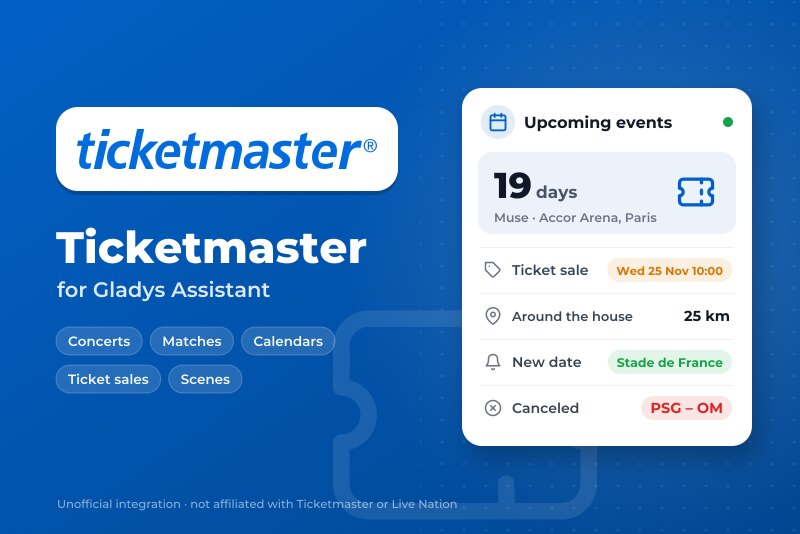
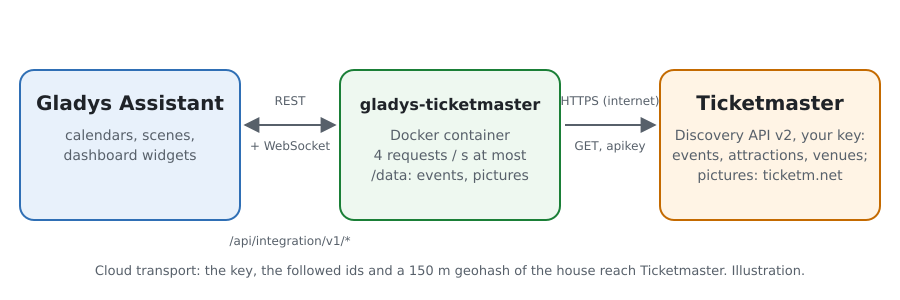
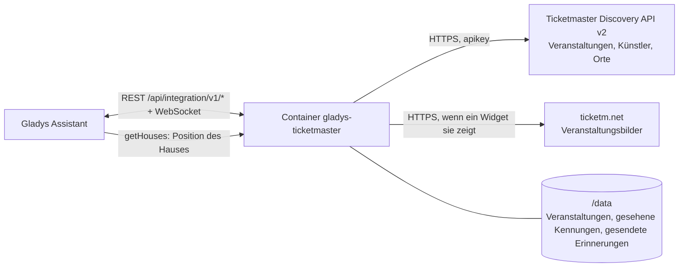
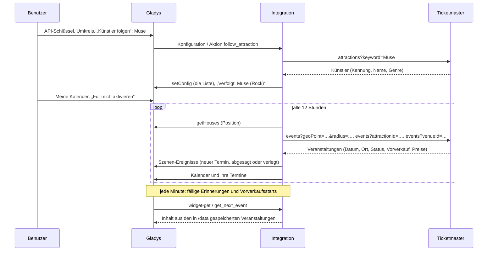
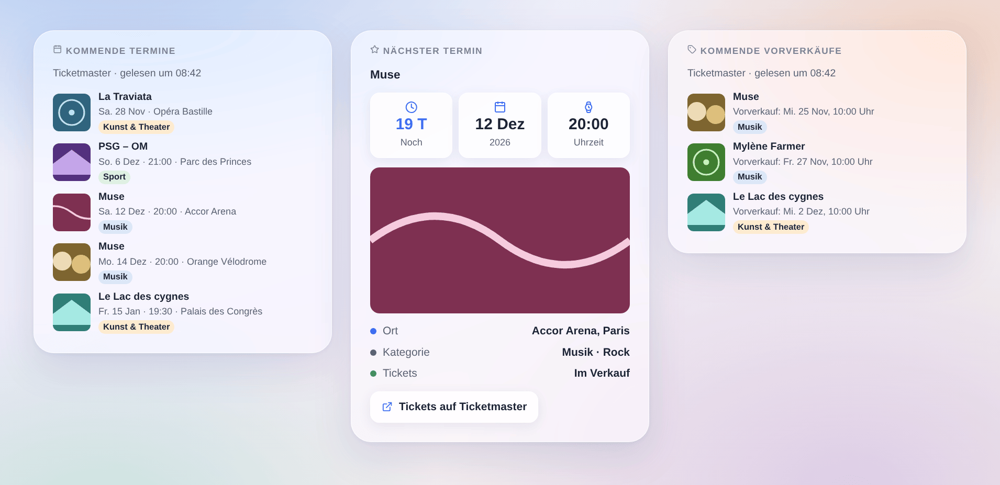

# Gladys Ticketmaster

[English](README.md) · [Français](README.fr.md) · **Deutsch** · [Español](README.es.md)

[](LICENSE)
[](https://github.com/William-De71/gladys-ticketmaster/releases)
[](https://github.com/William-De71/gladys-ticketmaster/actions/workflows/release.yml)
[](https://gladysassistant.com)



Eine externe Integration für [Gladys Assistant](https://gladysassistant.com), die **Konzerte, Shows und Spiele** von Ticketmaster in den Gladys-Kalender bringt: rund ums Haus, von den Künstlern und Teams, denen Sie folgen, und von Ihren Lieblingsorten. Szenen melden einen neuen Termin, den **Vorverkaufsstart** oder eine Absage, und drei Dashboard-Widgets zeigen, was kommt.

Benutzerdokumentation: [English](docs/en.md) · [Français](docs/fr.md) · [Deutsch](docs/de.md) · [Español](docs/es.md).

> Community-Integration, weder mit Ticketmaster oder Live Nation verbunden noch von ihnen unterstützt.

## Funktionen

- **Die offizielle Discovery API** von Ticketmaster, mit Ihrem eigenen kostenlosen Schlüssel (5.000 Anfragen pro Tag; die Integration braucht höchstens einige Hundert).
- **Drei Quellen, die sich addieren**: Veranstaltungen **rund ums Haus** (Umkreis, Kategorien, Zeitraum; die Position des Hauses kommt aus Gladys), **Künstler und Teams** sowie **Veranstaltungsorte**, verfolgt über Konfigurations-Schaltflächen (ein Name genügt).
- **Bis zu drei Kalender** pro Benutzer: „Meine Künstler und Teams“, „Meine Veranstaltungsorte“, „Veranstaltungen rund ums Haus“; jede Veranstaltung im persönlichsten, mit Uhrzeit, Ort, Kategorie, Vorverkauf und Preisen.
- **4 Szenen-Auslöser** (neuer Termin, Erinnerung, Vorverkaufsstart, abgesagt oder verlegt), **1 Szenen-Aktion**, **3 Dashboard-Widgets** und **6 Konfigurations-Schaltflächen**.
- Ein fehlgeschlagener Lesevorgang behält das Bekannte; das Tageskontingent und ein abgelehnter Schlüssel werden im Status der Integration angezeigt.
- Vier Sprachen überall: Deutsch, Englisch, Französisch, Spanisch.

## Funktionsweise





Alle 12 Stunden (6 bis 24) liest die Integration eine Suche pro Quelle: die Veranstaltungen im Umkreis des Hauses (als Geohash mit 7 Zeichen, etwa 150 m), die Termine jedes verfolgten Künstlers oder Teams im gewählten Land und das Programm jedes verfolgten Orts, seitenweise bis zur 1.000. Veranstaltung, höchstens 4 Anfragen pro Sekunde. 20 Künstler und 5 Orte sind etwa 30 Anfragen pro Lesevorgang.

Was sich geändert hat, löst die Szenen aus, dann werden die Kalender veröffentlicht. Der erste Lesevorgang einer Quelle ist eine Referenz: Einem neuen Künstler zu folgen kündigt nichts an. Eine Veranstaltung, die vor ihrem Termin aus den Antworten verschwindet, wird einmal nachgefragt: Meldet Ticketmaster sie als abgesagt, bleibt sie mit neuem Namen im Kalender; eine vergangene bleibt eine Woche.



### Transport

Nur Cloud (`"transports": ["cloud"]`): Der Katalog zeigt das Cloud-Abzeichen. Ticketmaster erhält den Schlüssel, die Kennungen der verfolgten Künstler, Teams und Orte und einen Geohash des Hauses (etwa 150 m), nie die Adresse; die Bilder werden von `ticketm.net` geladen, wenn ein Dashboard sie zeigt. Es gibt keinen lokalen Weg, daher keine Schaltfläche „Lokale Verbindung bevorzugen“. Das Manifest fordert `location` an, um die Position des Hauses zu lesen.

## Kalender und Termine

Keine Geräte: Gladys erlaubt nicht, dass eine Integration zugleich Kalender- und Geräte-Integration ist.

| Element      | Inhalt                                                                                                              |
| ------------ | ------------------------------------------------------------------------------------------------------------------- |
| Kalender     | „Meine Künstler und Teams“, „Meine Veranstaltungsorte“, „Veranstaltungen rund ums Haus“: einer pro genutzter Quelle |
| Termin       | Mit Uhrzeit, wenn bekannt (mit Ende, falls angegeben), sonst ganztägig; erst wenn ein Datum feststeht               |
| Titel        | Der Name der Veranstaltung; „Abgesagt · …“, „Verschoben · …“, wenn zutreffend                                       |
| Beschreibung | Kategorie und Genre, weitere Künstler, Vorverkauf, Preise, Quelle                                                   |
| Ort          | Der Veranstaltungsort und seine Stadt                                                                               |
| Link         | Die Ticketmaster-Seite der Veranstaltung                                                                            |

Das Fenster reicht von einer Woche zurück bis zwei Jahre voraus; mehr als 500 Termine werden in aufeinanderfolgenden Fenstern veröffentlicht. Unter „Meine Kalender“ kann jeder Benutzer die Synchronisierung eines Kalenders abschalten oder ihn **mit dem Haushalt teilen**: Nur ein geteilter Kalender erreicht die Szenen und den nativen Auslöser „Kalenderereignis steht bevor“.

## Szenen-Auslöser, Aktionen und Widgets



**Szenen-Auslöser** (einmal pro Übergang). Filter: Quelle (artist, venue, nearby), Kategorien, Name des Künstlers oder Teams.

- **Neuer Termin**: eine neue Veranstaltung ist erschienen (nie beim ersten Lesen einer Quelle, höchstens 20 pro Lesevorgang).
- **Erinnerung**: heute, morgen oder in einer Woche, zur Stunde der Konfiguration.
- **Vorverkaufsstart**: beim Start, eine Stunde vorher oder am Vortag.
- **Abgesagt oder verlegt**: abgesagt, verschoben, neuer Termin, anderer Tag oder andere Uhrzeit (`change`, `previous_date`).

Die Variablen: `name`, `date`, `time`, `date_text`, `days`, `place`, `city`, `attraction`, `segment`, `source`, `status`, `url`, `image_url`, `onsale`, `onsale_text`, `text`, `event_id` (und `lead`, `change`, `previous_date`).

**Szenen-Aktion**: **nächster Termin** (gleiche Filter): Name, Datum, Uhrzeit, Ort, Vorverkauf und ein fertiger Satz („Muse: in 19 Tagen, Samstag 12. Dezember 2026, 20:00 Uhr, Accor Arena, Paris.“).

**Widgets**: **Kommende Termine** (Liste mit Bildern), **Nächster Termin** (Countdown, großes Bild, Schaltfläche zu den Tickets) und **Kommende Vorverkäufe**. Einstellungen: Quellen, Kategorien, Anzahl.

**Konfigurations-Schaltflächen**: einem Künstler oder Team folgen / nicht mehr folgen, einem Ort folgen / nicht mehr folgen, Verfolgtes auflisten, jetzt neu lesen.

Beispiele:

- Wenn **der Vorverkauf in einer Stunde startet** → `{{triggerEvent.data.text}}` und `{{triggerEvent.data.url}}` per Telegram senden.
- Wenn **ein verfolgter Künstler einen neuen Termin ankündigt** → `{{triggerEvent.data.text}}` senden.
- **Erinnerung am Tag selbst** → Gladys `{{triggerEvent.data.text}}` sagen lassen.

## Voraussetzungen

- Gladys Assistant **5.3.0** oder neuer (Kalender-Integrationen). Ältere Instanzen können die Integration nicht installieren.
- Internetzugang und ein kostenloser Ticketmaster-API-Schlüssel ([Registrierung](https://developer-acct.ticketmaster.com/user/register), dann der „Consumer Key“ der Standard-App).
- Für „Rund ums Haus“: die Position des Hauses in Gladys.

## Installation

- **Aus dem Gladys-Store** (Integrationen → Externe Integrationen), mit einem Klick, sobald indexiert.
- **Über die URL des Repositorys**: `https://github.com/William-De71/gladys-ticketmaster`.
- **Entwicklermodus**: das Image lokal bauen (`docker build -t gladys-ticketmaster .`) und aus Gladys installieren.

## Konfiguration

| Feld                                           | Beschreibung                                                       |
| ---------------------------------------------- | ------------------------------------------------------------------ |
| Ticketmaster-API-Schlüssel                     | Pflicht, geheimes Feld, wird nur an Ticketmaster gesendet.         |
| Haus                                           | Leer: das erste Haus mit Position.                                 |
| Umkreis                                        | Aus, 5, 10, 25 (Standard), 50 oder 100 km.                         |
| Kategorien                                     | Standardmäßig Musik sowie Kunst & Theater; Sport, Film, Sonstiges. |
| Wie weit im Voraus                             | 30 Tage, 3 Monate (Standard), 6 Monate, ein Jahr.                  |
| Land der Termine verfolgter Künstler und Teams | Frankreich (Standard), ein anderes Land oder alle Länder.          |
| Lesen von Ticketmaster                         | Alle 6, 12 (Standard) oder 24 Stunden.                             |
| Stunde der Erinnerungen                        | 0 bis 23, Ortszeit (Standard 9).                                   |
| Sprache der Szenentexte                        | Automatisch (die Sprache des Dashboards) oder eine feste Sprache.  |

Die über die Schaltflächen verfolgten Künstler, Teams und Orte werden in der Konfiguration von Gladys gespeichert (sie folgen dessen Sicherungen). Klicken Sie anschließend auf derselben Seite unter **Meine Kalender** auf **Für mich aktivieren**.

## Verwendung

1. Schlüssel einfügen, Umkreis und Kategorien wählen, Künstlern, Teams oder Orten über die Schaltflächen folgen, dann speichern.
2. Unter **Meine Kalender** auf **Für mich aktivieren** klicken; die Kalender mit dem Haushalt teilen, um sie in Szenen zu nutzen.
3. Die Widgets einem Dashboard hinzufügen und Szenen mit den obigen Auslösern anlegen.

## Entwicklung

```bash
npm install
npm test                       # node --test, ohne Netzwerk
npm run lint && npm run format:check
npx github:GladysAssistant/integration-store . --skip-image-check
scripts/build-cover.sh         # cover.jpg aus docs/assets/cover.svg
docs/illustrations/render.sh   # docs/assets/widgets.<Sprache>.png
node .github/scripts/release.mjs next
```

Lokal liest das SDK `GLADYS_HOST_API_URL`, `GLADYS_INTEGRATION_TOKEN` und `GLADYS_INTEGRATION_SELECTOR`, und `TZ` setzt die Zeitzone; `DEBUG=gladys-integration-sdk` zeigt die SDK-Protokolle und prüft jeden Widget-Inhalt. Die Tests simulieren Ticketmaster mit Antworten, die nach seiner Dokumentation gebaut sind. Die Regeln des Projekts stehen in [CLAUDE.md](CLAUDE.md).

## Veröffentlichung


Jeder Merge auf `main` startet die CI und berechnet dann die Version aus den [Conventional Commits](https://www.conventionalcommits.org/) seit dem letzten Tag: `feat` → Minor, `fix` / `perf` → Patch, `!` oder `BREAKING CHANGE` → Major (vor 1.0.0 ein Minor); `docs`, `chore`, `ci`, `test`, `style`, `refactor`, `build` allein veröffentlichen nichts. Der Changelog-Abschnitt wird erzeugt, der Tag gepusht, das Multi-Arch-Image gebaut, dann erhält `main` den Versions-Commit, das GitHub-Release wird erstellt und ein letzter Job prüft das öffentliche Image, den Store-Validator und das Topic.

- Der Titel des Pull Requests wird zum Squash-Commit und dann zur Changelog-Zeile: auf Englisch, für den Benutzer (`pr-title.yml` prüft ihn). `CHANGELOG.md` nie von Hand ändern.
- 1.0.0 ist eine Entscheidung: Actions → Release → Run workflow mit `release-as: 1.0.0`. `dry-run` zeigt Version und Notizen, ohne etwas zu veröffentlichen.
- Nach dem ersten Release das Paket auf `ghcr.io` öffentlich machen (Package settings → Change visibility), sonst kann Gladys es nicht herunterladen.

## Fehlerbehebung

Siehe [docs/de.md](docs/de.md#fehlerbehebung). Melden Sie Probleme mit den Versionen von Gladys und der Integration, dem Verfolgten (nie den Schlüssel) und den Zeilen des Protokoll-Tabs.

## Mitwirken

Issues und Pull Requests sind willkommen. Führen Sie vor einem Pull Request `npm run format:check && npm run lint && npm test` aus und ändern Sie keine externe Kennung und keinen gespeicherten Schlüssel (siehe [CLAUDE.md](CLAUDE.md)).

## Sicherheit

Siehe [SECURITY.md](SECURITY.md): Schwachstellen bitte vertraulich melden. Der API-Schlüssel ist ein geheimes Feld und steht nie in den Protokollen, in `/data` oder in einer Fehlermeldung; die Integration läuft schreibgeschützt, ohne Root-Rechte, in ihrem Container und kontaktiert nur die Discovery API und die Bildserver von Ticketmaster.

## Kommende Bildschirmfotos

Die Bilder oben sind Illustrationen, keine Bildschirmfotos. Echte Bildschirmfotos kommen nach `docs/assets/screenshots/` (PNG, 1280 × 800): `configuration.png`, `my-calendars.png`, `calendar.png`, `scene.png`.

## Lizenz

[Apache-Lizenz 2.0](LICENSE) — siehe auch [NOTICE](NOTICE). Die Veranstaltungen und ihre Bilder gehören Ticketmaster und den Veranstaltern; sie werden nach den Nutzungsbedingungen von Ticketmaster mit dem Schlüssel jedes Benutzers gelesen. Dank an die Dokumentation und das SDK von Gladys.
