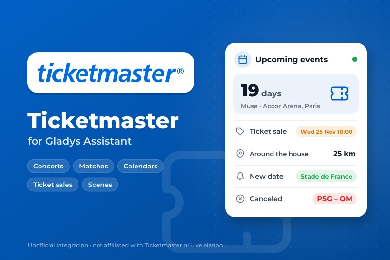
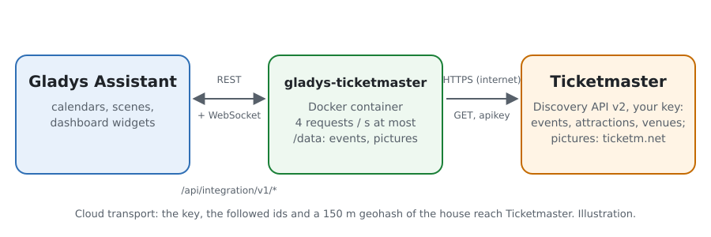
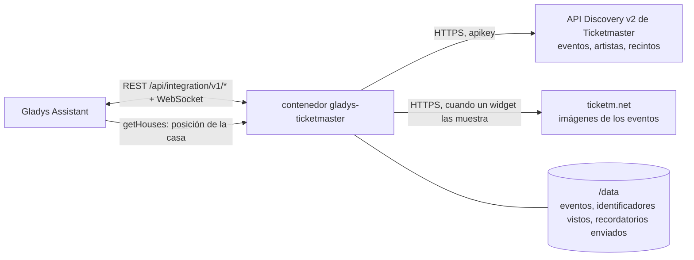
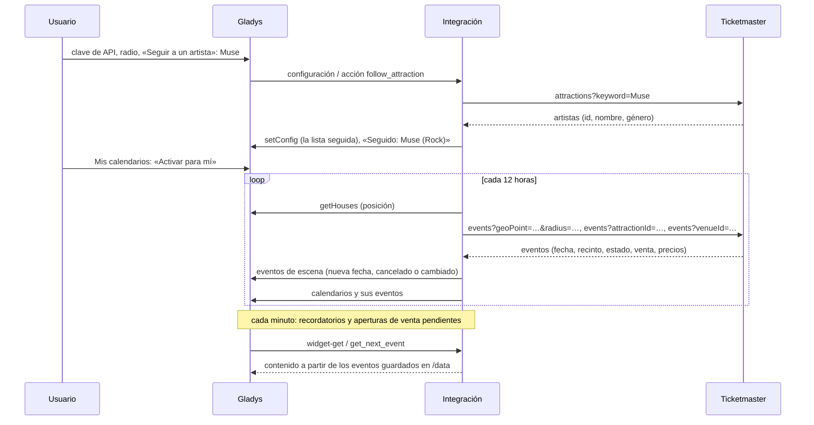
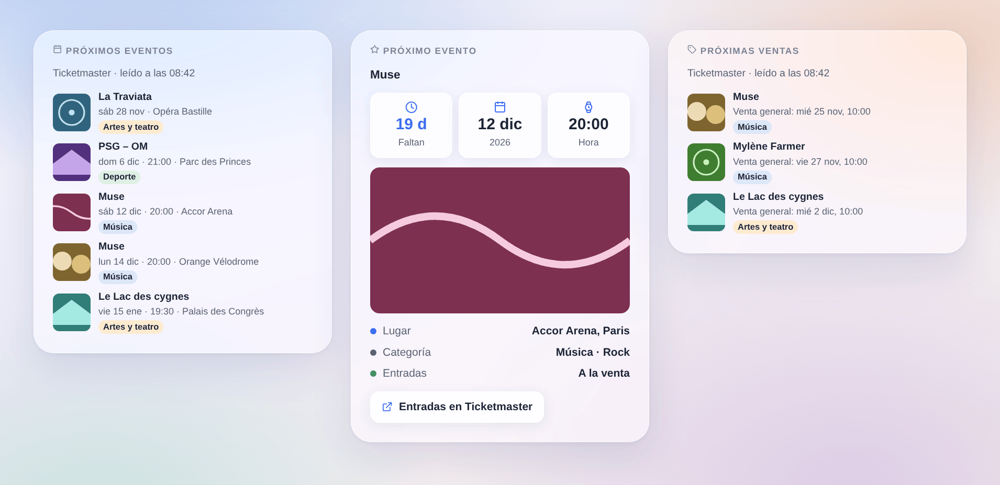

# Gladys Ticketmaster

[English](README.md) · [Français](README.fr.md) · [Deutsch](README.de.md) · **Español**

[](LICENSE)
[](https://github.com/William-De71/gladys-ticketmaster/releases)
[](https://github.com/William-De71/gladys-ticketmaster/actions/workflows/release.yml)
[](https://gladysassistant.com)



Una integración externa de [Gladys Assistant](https://gladysassistant.com) que lleva los **conciertos, espectáculos y partidos** de Ticketmaster al calendario de Gladys: alrededor de la casa, de los artistas y equipos que sigue y de sus recintos favoritos. Las escenas le avisan de una nueva fecha, de la **apertura de la venta de entradas** o de una cancelación, y tres widgets del panel muestran lo que viene.

Documentación de usuario: [English](docs/en.md) · [Français](docs/fr.md) · [Deutsch](docs/de.md) · [Español](docs/es.md).

> Integración comunitaria, no afiliada a Ticketmaster ni a Live Nation ni respaldada por ellos.

## Funciones

- **La API Discovery oficial** de Ticketmaster, con su propia clave gratuita (5.000 peticiones al día; la integración usa unos cientos como máximo).
- **Tres fuentes que se suman**: los eventos **alrededor de la casa** (radio, categorías, hasta cuándo; la posición de la casa viene de Gladys), **artistas y equipos** y **recintos** seguidos con botones de configuración (basta un nombre).
- **Hasta tres calendarios** por usuario: «Mis artistas y equipos», «Mis recintos», «Eventos alrededor de casa»; cada evento en el más personal, con hora, recinto, categoría, venta y precios.
- **4 disparadores de escena** (nueva fecha, recordatorio, apertura de venta, cancelado o cambiado), **1 acción de escena**, **3 widgets** y **6 botones de configuración**.
- Una lectura fallida conserva lo conocido; la cuota diaria y una clave rechazada se indican en el estado de la integración.
- Cuatro idiomas en todas partes: español, inglés, francés, alemán.

## Funcionamiento





Cada 12 horas (6 a 24), la integración hace una búsqueda por fuente: los eventos dentro del radio de la casa (como geohash de 7 caracteres, unos 150 m), las fechas de cada artista o equipo seguido en el país elegido y la programación de cada recinto seguido, paginadas hasta el evento 1.000, 4 peticiones por segundo como máximo. 20 artistas y 5 recintos son unas 30 peticiones por lectura.

Lo que cambió lanza los disparadores de escena y luego se publican los calendarios. La primera lectura de una fuente es una referencia: seguir a un nuevo artista no anuncia nada. Un evento que desaparece de las respuestas antes de su fecha se vuelve a consultar una vez: si Ticketmaster lo da por cancelado, se queda en el calendario con su nuevo nombre; un evento pasado se queda una semana.



### Transporte

Solo nube (`"transports": ["cloud"]`): el catálogo muestra la insignia de nube. Ticketmaster recibe la clave, los identificadores de los artistas, equipos y recintos seguidos y un geohash de la casa (unos 150 m), nunca la dirección; las imágenes se descargan de `ticketm.net` cuando un panel las muestra. No hay vía local, por lo tanto no hay botón «Preferir la conexión local». El manifiesto pide `location` para leer la posición de la casa.

## Calendarios y eventos

Sin dispositivos: Gladys no permite que una integración sea a la vez de calendario y de dispositivos.

| Elemento    | Contenido                                                                                       |
| ----------- | ----------------------------------------------------------------------------------------------- |
| Calendarios | «Mis artistas y equipos», «Mis recintos», «Eventos alrededor de casa»: uno por fuente en uso    |
| Evento      | Con hora si se conoce (con su fin si se indica), si no de día completo; no antes de tener fecha |
| Título      | El nombre del evento; «Cancelado · …», «Aplazado · …» si procede                                |
| Descripción | Categoría y género, otros artistas, venta, precios, fuente                                      |
| Lugar       | El recinto y su ciudad                                                                          |
| Enlace      | La página de Ticketmaster del evento                                                            |

La ventana va de una semana atrás a dos años por delante; más de 500 eventos se publican en ventanas sucesivas. En «Mis calendarios», cada usuario puede dejar de sincronizar un calendario o **compartirlo con el hogar**: solo un calendario compartido llega a las escenas y al disparador nativo «Se acerca un evento del calendario».

## Disparadores, acciones y widgets



**Disparadores de escena** (una vez por transición). Filtros: fuente (artist, venue, nearby), categorías, nombre del artista o equipo.

- **Nueva fecha**: ha aparecido un nuevo evento (nunca en la primera lectura de una fuente, 20 como máximo por lectura).
- **Recordatorio**: hoy, mañana o dentro de una semana, a la hora de la configuración.
- **Apertura de venta**: en la apertura, una hora antes o la víspera.
- **Cancelado o cambiado**: cancelado, aplazado, nueva fecha, otro día u hora (`change`, `previous_date`).

Las variables: `name`, `date`, `time`, `date_text`, `days`, `place`, `city`, `attraction`, `segment`, `source`, `status`, `url`, `image_url`, `onsale`, `onsale_text`, `text`, `event_id` (y `lead`, `change`, `previous_date`).

**Acción de escena**: **próximo evento** (mismos filtros): nombre, fecha, hora, lugar, venta y una frase hecha («Muse: dentro de 19 días, sábado 12 de diciembre de 2026, 20:00, Accor Arena, Paris.»).

**Widgets**: **Próximos eventos** (lista con imágenes), **Próximo evento** (cuenta atrás, imagen grande, botón hacia las entradas) y **Próximas ventas**. Ajustes: fuentes, categorías, número mostrado.

**Botones de configuración**: seguir / dejar de seguir a un artista o equipo, seguir / dejar de seguir un recinto, listar lo que se sigue, volver a leer ahora.

Ejemplos:

- Cuando **la venta abre dentro de una hora** → enviar `{{triggerEvent.data.text}}` y `{{triggerEvent.data.url}}` por Telegram.
- Cuando **un artista seguido anuncia una nueva fecha** → enviar `{{triggerEvent.data.text}}`.
- **Recordatorio el mismo día** → hacer que Gladys diga `{{triggerEvent.data.text}}`.

## Requisitos

- Gladys Assistant **5.3.0** o posterior (integraciones de calendario). Las instancias más antiguas no pueden instalar la integración.
- Acceso a Internet y una clave de API de Ticketmaster gratuita ([registro](https://developer-acct.ticketmaster.com/user/register), luego la «Consumer Key» de la aplicación por defecto).
- Para «Alrededor de la casa»: la posición de la casa en Gladys.

## Instalación

- **Desde la tienda de Gladys** (Integraciones → Integraciones externas), con un clic, una vez indexada.
- **Desde la URL del repositorio**: `https://github.com/William-De71/gladys-ticketmaster`.
- **Modo desarrollador**: construya la imagen en local (`docker build -t gladys-ticketmaster .`) e instálela desde Gladys.

## Configuración

| Campo                                             | Descripción                                                |
| ------------------------------------------------- | ---------------------------------------------------------- |
| Clave de API de Ticketmaster                      | Obligatoria, campo secreto, solo se envía a Ticketmaster.  |
| Casa                                              | Vacío: la primera casa con posición.                       |
| Radio                                             | Desactivado, 5, 10, 25 (por defecto), 50 o 100 km.         |
| Categorías                                        | Música y artes y teatro por defecto; deporte, cine, otros. |
| Hasta cuándo                                      | 30 días, 3 meses (por defecto), 6 meses, un año.           |
| País de las fechas de artistas y equipos seguidos | Francia (por defecto), otro país o todos los países.       |
| Lectura de Ticketmaster                           | Cada 6, 12 (por defecto) o 24 horas.                       |
| Hora de los recordatorios                         | 0 a 23, hora local (9 por defecto).                        |
| Idioma de los textos de las escenas               | Automático (el idioma del panel), o un idioma fijo.        |

Los artistas, equipos y recintos seguidos con los botones se guardan en la configuración de Gladys (siguen sus copias de seguridad). Después, en **Mis calendarios** en la misma página, pulse **Activar para mí**.

## Uso

1. Pegue la clave, elija un radio y categorías, siga artistas, equipos o recintos con los botones y guarde.
2. En **Mis calendarios**, pulse **Activar para mí**; comparta los calendarios con el hogar para usarlos en escenas.
3. Añada los widgets a un panel y cree escenas con los disparadores anteriores.

## Desarrollo

```bash
npm install
npm test                       # node --test, sin red
npm run lint && npm run format:check
npx github:GladysAssistant/integration-store . --skip-image-check
scripts/build-cover.sh         # cover.jpg desde docs/assets/cover.svg
docs/illustrations/render.sh   # docs/assets/widgets.<idioma>.png
node .github/scripts/release.mjs next
```

En local, el SDK lee `GLADYS_HOST_API_URL`, `GLADYS_INTEGRATION_TOKEN` y `GLADYS_INTEGRATION_SELECTOR`, y `TZ` fija la zona horaria; `DEBUG=gladys-integration-sdk` muestra los registros del SDK y comprueba cada contenido de widget. Las pruebas simulan Ticketmaster con respuestas construidas a partir de su documentación. Las reglas del proyecto están en [CLAUDE.md](CLAUDE.md).

## Publicación de versiones


Cada fusión en `main` lanza la CI y luego calcula la versión a partir de los [Conventional Commits](https://www.conventionalcommits.org/) desde la última etiqueta: `feat` → menor, `fix` / `perf` → parche, `!` o `BREAKING CHANGE` → mayor (una menor antes de 1.0.0); `docs`, `chore`, `ci`, `test`, `style`, `refactor`, `build` solos no publican nada. Se genera la sección del changelog, se sube la etiqueta, se construye la imagen multiarquitectura, `main` recibe el commit de versión, se crea la Release de GitHub y un último job comprueba la imagen pública, el validador de la tienda y el topic.

- El título de la pull request se convierte en el commit squash y luego en la línea del changelog: escríbalo en inglés, para el usuario (`pr-title.yml` lo comprueba). No edite nunca `CHANGELOG.md` a mano.
- La 1.0.0 es una decisión: Actions → Release → Run workflow con `release-as: 1.0.0`. `dry-run` muestra la versión y las notas sin publicar nada.
- Tras la primera versión, haga público el paquete de `ghcr.io` (Package settings → Change visibility); si no, Gladys no puede descargarlo.

## Solución de problemas

Vea [docs/es.md](docs/es.md#solución-de-problemas). Informe de los problemas con las versiones de Gladys y de la integración, lo que se sigue (nunca la clave) y las líneas de la pestaña Registros.

## Contribuir

Las issues y pull requests son bienvenidas. Ejecute `npm run format:check && npm run lint && npm test` antes de abrir una pull request y no cambie ningún identificador externo ni clave guardada (vea [CLAUDE.md](CLAUDE.md)).

## Seguridad

Vea [SECURITY.md](SECURITY.md): informe de las vulnerabilidades en privado. La clave de API es un campo secreto, nunca escrita en los registros, en `/data` ni en un mensaje de error; la integración se ejecuta en solo lectura, sin derechos de root, en su contenedor, y solo contacta con la API Discovery y los servidores de imágenes de Ticketmaster.

## Capturas pendientes

Las imágenes anteriores son ilustraciones, no capturas. Las capturas reales irán a `docs/assets/screenshots/` (PNG, 1280 × 800): `configuration.png`, `my-calendars.png`, `calendar.png`, `scene.png`.

## Licencia

[Licencia Apache 2.0](LICENSE) — vea también [NOTICE](NOTICE). Los eventos y sus imágenes pertenecen a Ticketmaster y a los organizadores; se leen según las condiciones de uso de Ticketmaster con la clave de cada usuario. Gracias a la documentación y al SDK de Gladys.
