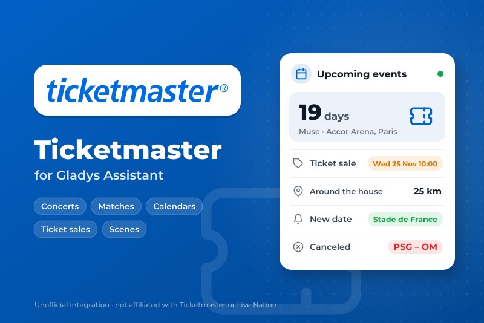
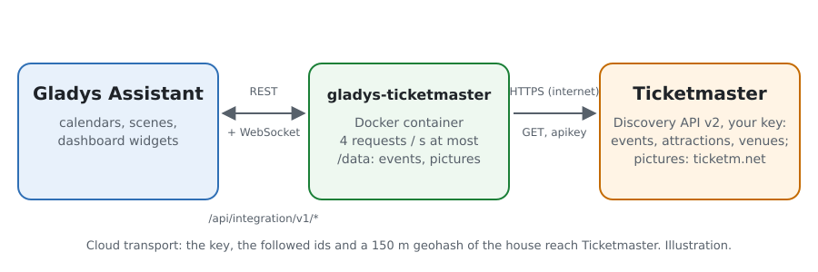
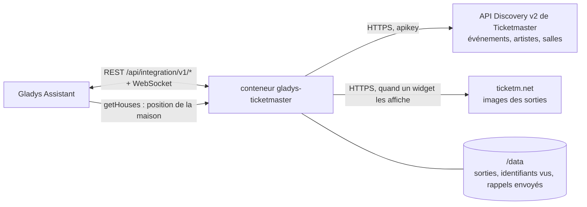
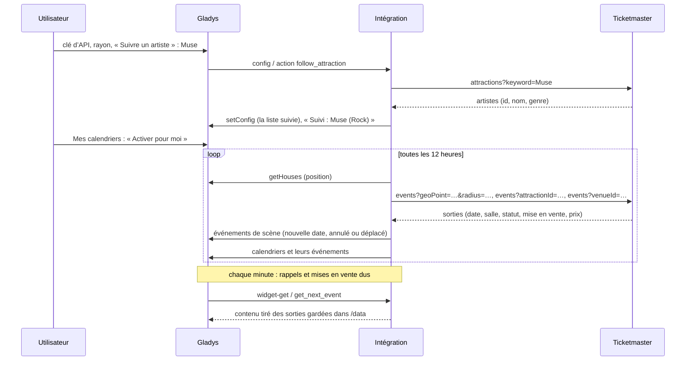
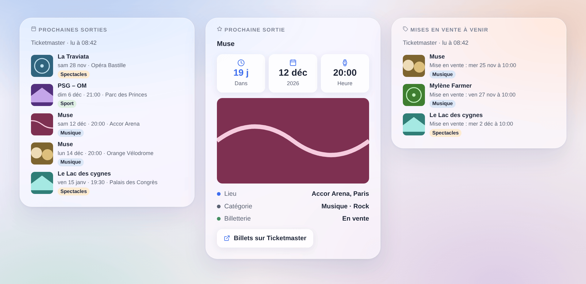

# Gladys Ticketmaster

[English](README.md) · **Français** · [Deutsch](README.de.md) · [Español](README.es.md)

[](LICENSE)
[](https://github.com/William-De71/gladys-ticketmaster/releases)
[](https://github.com/William-De71/gladys-ticketmaster/actions/workflows/release.yml)
[](https://gladysassistant.com)



Une intégration externe de [Gladys Assistant](https://gladysassistant.com) qui amène les **concerts, spectacles et matchs** de Ticketmaster dans le calendrier de Gladys : autour de la maison, des artistes et équipes que vous suivez, et de vos salles préférées. Les scènes vous préviennent d’une nouvelle date, de l’**ouverture de la billetterie** ou d’une annulation, et trois widgets du tableau de bord montrent ce qui arrive.

Documentation utilisateur : [English](docs/en.md) · [Français](docs/fr.md) · [Deutsch](docs/de.md) · [Español](docs/es.md).

> Intégration communautaire, ni affiliée à Ticketmaster ou Live Nation, ni approuvée par eux.

## Fonctionnalités

- **L’API Discovery officielle** de Ticketmaster, avec votre propre clé gratuite (5 000 requêtes par jour ; l’intégration en utilise quelques centaines au plus).
- **Trois sources qui s’additionnent** : les sorties **autour de la maison** (rayon, catégories, jusqu’à quand ; la position de la maison vient de Gladys), des **artistes et équipes** et des **salles** suivis avec des boutons de configuration (un nom suffit).
- **Jusqu’à trois calendriers** par utilisateur : « Mes artistes et équipes », « Mes salles », « Sorties autour de la maison » ; chaque sortie dans le plus personnel, avec heure, salle, catégorie, mise en vente et prix.
- **4 déclencheurs de scène** (nouvelle date, rappel, mise en vente, annulé ou déplacé), **1 action de scène**, **3 widgets** et **6 boutons de configuration**.
- Une lecture ratée garde ce qui était connu ; le quota quotidien et une clé refusée sont signalés dans l’état de l’intégration.
- Quatre langues partout : français, anglais, allemand, espagnol.

## Fonctionnement





Toutes les 12 heures (6 à 24), l’intégration fait une recherche par source : les sorties dans le rayon de la maison (sous forme de geohash de 7 caractères, environ 150 m), les dates de chaque artiste ou équipe suivi dans le pays choisi, et la programmation de chaque salle suivie, paginées jusqu’à la 1 000e, 4 requêtes par seconde au plus. 20 artistes et 5 salles font environ 30 requêtes par lecture.

Ce qui a changé lance les déclencheurs de scène, puis les calendriers sont publiés. La première lecture d’une source sert de référence : suivre un nouvel artiste n’annonce rien. Une sortie qui disparaît des réponses avant sa date est redemandée une fois : si Ticketmaster la dit annulée, elle reste dans le calendrier avec son nouveau nom ; une sortie passée reste une semaine.



### Transport

Cloud uniquement (`"transports": ["cloud"]`) : le catalogue affiche le badge cloud. Ticketmaster reçoit la clé, les identifiants des artistes, équipes et salles suivis et un geohash de la maison (environ 150 m), jamais l’adresse ; les images sont téléchargées depuis `ticketm.net` quand un tableau de bord les affiche. Il n’y a pas de voie locale, donc pas de bouton « Préférer la connexion locale ». Le manifeste demande `location` pour lire la position de la maison.

## Calendriers et événements

Pas d’appareils : Gladys ne permet pas qu’une intégration soit à la fois de calendrier et d’appareils.

| Élément     | Contenu                                                                                                                    |
| ----------- | -------------------------------------------------------------------------------------------------------------------------- |
| Calendriers | « Mes artistes et équipes », « Mes salles », « Sorties autour de la maison » : un par source utilisée                      |
| Événement   | Horaire quand l’heure est connue (avec sa fin si elle est donnée), sinon sur la journée ; pas avant qu’une date soit fixée |
| Titre       | Le nom de la sortie ; « Annulé · … », « Reporté · … » le cas échéant                                                       |
| Description | Catégorie et genre, autres artistes, mise en vente, prix, source                                                           |
| Lieu        | La salle et sa ville                                                                                                       |
| Lien        | La page Ticketmaster de la sortie                                                                                          |

La fenêtre va d’une semaine en arrière à deux ans en avant ; au-delà de 500 sorties, la publication se fait en fenêtres successives. Dans « Mes calendriers », chaque utilisateur peut arrêter la synchronisation d’un calendrier ou le **partager avec la maison** : seul un calendrier partagé atteint les scènes et le déclencheur natif « Un événement du calendrier approche ».

## Déclencheurs, actions et widgets



**Déclencheurs de scène** (une fois par transition). Filtres : source (artist, venue, nearby), catégories, nom de l’artiste ou de l’équipe.

- **Nouvelle date** : une nouvelle sortie est apparue (jamais à la première lecture d’une source, 20 au plus par lecture).
- **Rappel** : aujourd’hui, demain ou dans une semaine, à l’heure de la configuration.
- **Mise en vente** : à l’ouverture, une heure avant ou la veille.
- **Annulé ou déplacé** : annulé, reporté, nouvelle date, autre jour ou heure (`change`, `previous_date`).

Les variables : `name`, `date`, `time`, `date_text`, `days`, `place`, `city`, `attraction`, `segment`, `source`, `status`, `url`, `image_url`, `onsale`, `onsale_text`, `text`, `event_id` (et `lead`, `change`, `previous_date`).

**Action de scène** : **prochaine sortie** (mêmes filtres) : nom, date, heure, lieu, mise en vente et une phrase toute faite (« Muse : dans 19 jours, samedi 12 décembre 2026 à 20:00, Accor Arena, Paris. »).

**Widgets** : **Prochaines sorties** (liste avec images), **Prochaine sortie** (compte à rebours, grande image, bouton vers les billets) et **Mises en vente à venir**. Réglages : sources, catégories, nombre listé.

**Boutons de configuration** : suivre / ne plus suivre un artiste ou une équipe, suivre / ne plus suivre une salle, lister ce qui est suivi, relire maintenant.

Exemples :

- Quand **la billetterie ouvre dans une heure** → envoyer `{{triggerEvent.data.text}}` et `{{triggerEvent.data.url}}` sur Telegram.
- Quand **un artiste suivi annonce une nouvelle date** → envoyer `{{triggerEvent.data.text}}`.
- **Rappel le jour même** → faire dire `{{triggerEvent.data.text}}` à Gladys.

## Prérequis

- Gladys Assistant **5.3.0** ou plus récent (intégrations de calendrier). Les instances plus anciennes ne peuvent pas installer l’intégration.
- Un accès à Internet et une clé d’API Ticketmaster gratuite ([inscription](https://developer-acct.ticketmaster.com/user/register), puis la « Consumer Key » de l’application par défaut).
- Pour « Autour de la maison » : la position de la maison dans Gladys.

## Installation

- **Depuis le store de Gladys** (Intégrations → Intégrations externes), en un clic, une fois indexée.
- **Depuis l’URL du dépôt** : `https://github.com/William-De71/gladys-ticketmaster`.
- **Mode développeur** : construisez l’image en local (`docker build -t gladys-ticketmaster .`) et installez-la depuis Gladys.

## Configuration

| Champ                                         | Description                                                     |
| --------------------------------------------- | --------------------------------------------------------------- |
| Clé d’API Ticketmaster                        | Obligatoire, champ secret, envoyée uniquement à Ticketmaster.   |
| Maison                                        | Vide : la première maison qui a une position.                   |
| Rayon                                         | Désactivé, 5, 10, 25 (par défaut), 50 ou 100 km.                |
| Catégories                                    | Musique et spectacles par défaut ; sport, cinéma, divers.       |
| Jusqu’à quand                                 | 30 jours, 3 mois (par défaut), 6 mois, un an.                   |
| Pays des dates des artistes et équipes suivis | France (par défaut), un autre pays, ou tous les pays.           |
| Lecture de Ticketmaster                       | Toutes les 6, 12 (par défaut) ou 24 heures.                     |
| Heure des rappels                             | 0 à 23, heure locale (9 par défaut).                            |
| Langue des textes des scènes                  | Automatique (la langue du tableau de bord), ou une langue fixe. |

Les artistes, équipes et salles suivis avec les boutons sont gardés dans la configuration de Gladys (ils suivent ses sauvegardes). Ensuite, dans **Mes calendriers** sur la même page, cliquez sur **Activer pour moi**.

## Utilisation

1. Collez la clé, choisissez un rayon et des catégories, suivez des artistes, équipes ou salles avec les boutons, puis enregistrez.
2. Dans **Mes calendriers**, cliquez sur **Activer pour moi** ; partagez les calendriers avec la maison pour les utiliser dans les scènes.
3. Ajoutez les widgets à un tableau de bord et créez des scènes avec les déclencheurs ci-dessus.

## Développement

```bash
npm install
npm test                       # node --test, sans réseau
npm run lint && npm run format:check
npx github:GladysAssistant/integration-store . --skip-image-check
scripts/build-cover.sh         # cover.jpg depuis docs/assets/cover.svg
docs/illustrations/render.sh   # docs/assets/widgets.<langue>.png
node .github/scripts/release.mjs next
```

En local, le SDK lit `GLADYS_HOST_API_URL`, `GLADYS_INTEGRATION_TOKEN` et `GLADYS_INTEGRATION_SELECTOR`, et `TZ` fixe le fuseau horaire ; `DEBUG=gladys-integration-sdk` affiche les journaux du SDK et vérifie chaque contenu de widget. Les tests simulent Ticketmaster avec des réponses construites d’après sa documentation. Les règles du projet sont dans [CLAUDE.md](CLAUDE.md).

## Publication des versions


Chaque fusion sur `main` lance la CI, puis calcule la version à partir des [Conventional Commits](https://www.conventionalcommits.org/) depuis le dernier tag : `feat` → mineure, `fix` / `perf` → correctif, `!` ou `BREAKING CHANGE` → majeure (une mineure avant 1.0.0) ; `docs`, `chore`, `ci`, `test`, `style`, `refactor`, `build` seuls ne publient rien. La section du changelog est générée, le tag poussé, l’image multi-architecture construite, puis `main` reçoit le commit de version, la Release GitHub est créée et un dernier job vérifie l’image publique, le validateur du store et le topic.

- Le titre de la pull request devient le commit squash, puis la ligne du changelog : écrivez-le en anglais, pour l’utilisateur (`pr-title.yml` le vérifie). Ne modifiez jamais `CHANGELOG.md` à la main.
- La 1.0.0 est une décision : Actions → Release → Run workflow avec `release-as: 1.0.0`. `dry-run` montre la version et les notes sans rien publier.
- Après la première version, rendez le paquet `ghcr.io` public (Package settings → Change visibility), sinon Gladys ne peut pas le télécharger.

## Dépannage

Voir [docs/fr.md](docs/fr.md#dépannage). Signalez un problème avec les versions de Gladys et de l’intégration, ce qui est suivi (jamais la clé) et les lignes de l’onglet Journaux.

## Contribuer

Les issues et pull requests sont bienvenues. Lancez `npm run format:check && npm run lint && npm test` avant d’ouvrir une pull request, et ne changez aucun identifiant externe ni aucune clé stockée (voir [CLAUDE.md](CLAUDE.md)).

## Sécurité

Voir [SECURITY.md](SECURITY.md) : signalez les vulnérabilités en privé. La clé d’API est un champ secret, jamais écrite dans les journaux, dans `/data` ni dans un message d’erreur ; l’intégration tourne en lecture seule, sans droits root, dans son conteneur, et ne contacte que l’API Discovery et les serveurs d’images de Ticketmaster.

## Captures à venir

Les images ci-dessus sont des illustrations, pas des captures. Les vraies captures iront dans `docs/assets/screenshots/` (PNG, 1280 × 800) : `configuration.png`, `my-calendars.png`, `calendar.png`, `scene.png`.

## Licence

[Licence Apache 2.0](LICENSE) — voir aussi [NOTICE](NOTICE). Les sorties et leurs images appartiennent à Ticketmaster et aux organisateurs ; elles sont lues selon les conditions d’utilisation de Ticketmaster avec la clé de chaque utilisateur. Merci à la documentation et au SDK de Gladys.
