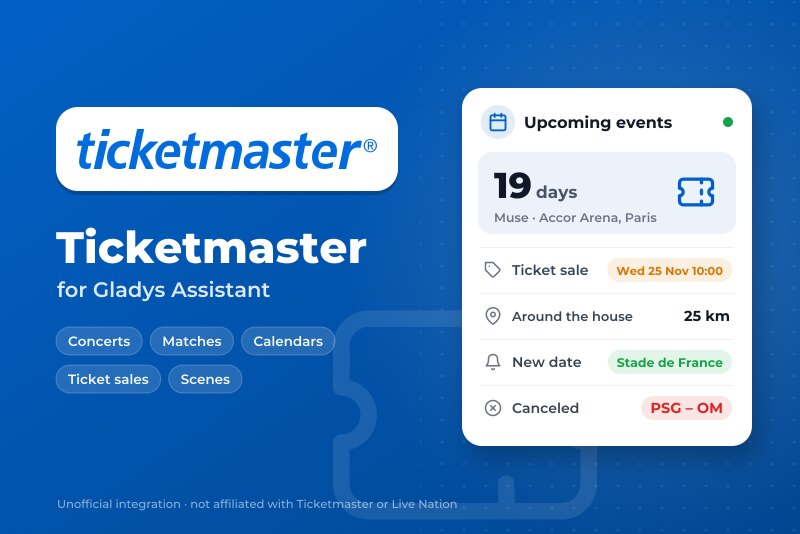
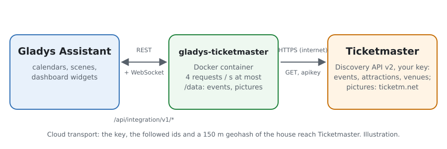
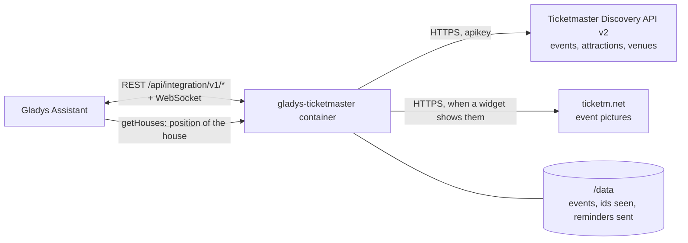
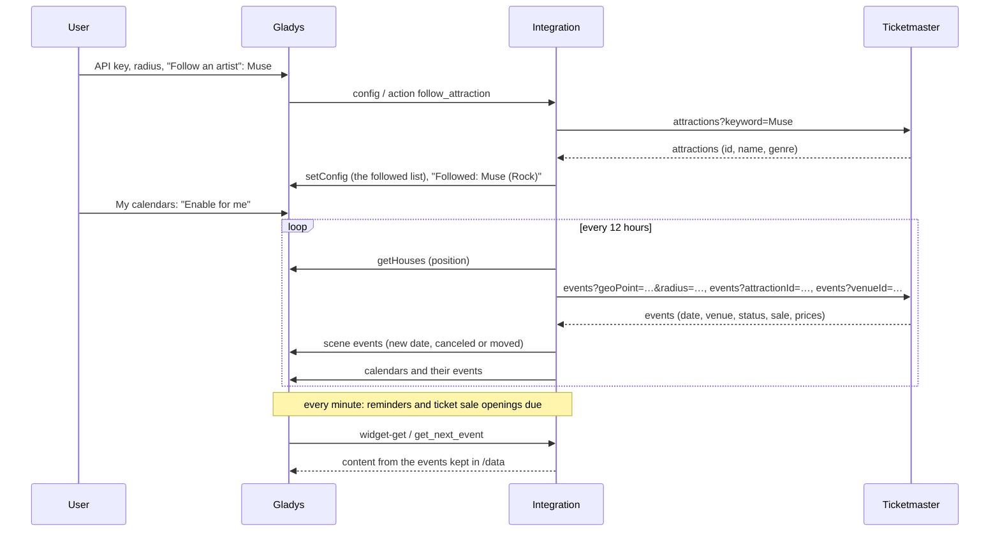
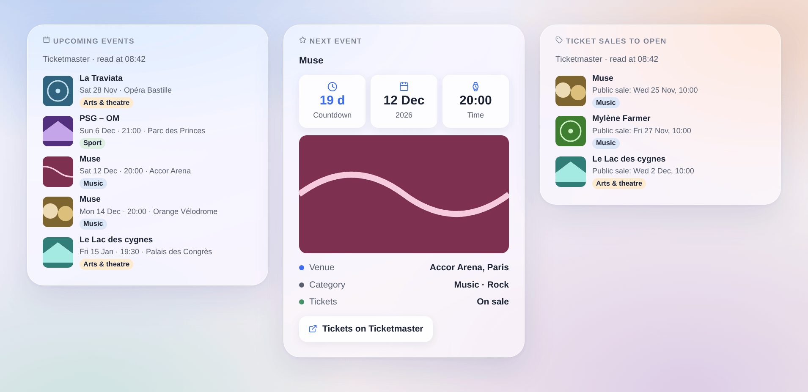

# Gladys Ticketmaster

**English** · [Français](README.fr.md) · [Deutsch](README.de.md) · [Español](README.es.md)

[](LICENSE)
[](https://github.com/William-De71/gladys-ticketmaster/releases)
[](https://github.com/William-De71/gladys-ticketmaster/actions/workflows/release.yml)
[](https://gladysassistant.com)



A [Gladys Assistant](https://gladysassistant.com) external integration that brings **concerts, shows and matches** from Ticketmaster into the Gladys calendar: around the house, of the artists and teams you follow, and of your favourite venues. Scenes can warn you when a new date is announced, when the **ticket sale opens** or when an event is canceled, and three dashboard widgets show what is coming.

User documentation: [English](docs/en.md) · [Français](docs/fr.md) · [Deutsch](docs/de.md) · [Español](docs/es.md).

> Community integration, not affiliated with or endorsed by Ticketmaster or Live Nation.

## Features

- **The official Discovery API** of Ticketmaster, with your own free key (5,000 requests a day; the integration uses a few hundred at most).
- **Three sources, which add up**: the events **around the house** (radius, categories, how far ahead; the position of the house comes from Gladys), **artists and teams** and **venues** followed with configuration buttons (a name is enough).
- **Up to three calendars** per user: "My artists and teams", "My venues", "Events around the house"; each event in the most personal one, with time, venue, category, sale and prices.
- **4 scene triggers** (new date, reminder, ticket sale opening, canceled or moved), **1 scene action**, **3 dashboard widgets** and **6 configuration buttons**.
- A failed reading keeps what was known; the daily quota and a refused key are told in the status of the integration.
- Four languages everywhere: English, French, German, Spanish.

## How it works





Every 12 hours (6 to 24), the integration reads one search per source: the events within the radius of the house (as a geohash of 7 characters, about 150 m), the events of each followed artist or team in the chosen country, and the programme of each followed venue, paged up to the 1,000th event, 4 requests a second at most. 20 artists and 5 venues are about 30 requests per reading.

What changed fires the scene triggers, then the calendars are published. The first reading of a source is a baseline: following a new artist announces nothing. A show that leaves the answers before its date is asked once more: if Ticketmaster says it is canceled, it stays in the calendar with its new name; a show that took place stays a week.



### Transport

Cloud only (`"transports": ["cloud"]`): the catalog shows the cloud badge. Ticketmaster receives the key, the identifiers of the followed artists, teams and venues, and a geohash of the house (about 150 m), never the address; the pictures are downloaded from `ticketm.net` when a dashboard shows them. There is no local path, hence no "Prefer the local connection" button. The manifest asks for `location` to read the position of the house.

## Calendars and events

No devices: Gladys does not let one integration be both a calendar and a device integration.

| Item        | Content                                                                                   |
| ----------- | ----------------------------------------------------------------------------------------- |
| Calendars   | "My artists and teams", "My venues", "Events around the house": one per source in use     |
| Event       | Timed when the time is known (its end when given), else all-day; not before a date is set |
| Title       | The name of the event; "Canceled · …", "Postponed · …" when it is                         |
| Description | Category and genre, other artists, public sale, prices, source                            |
| Location    | The venue and its city                                                                    |
| Link        | The Ticketmaster page of the event                                                        |

The window goes from a week back to two years ahead; more than 500 events are published in consecutive windows. In "My calendars", each user can stop synchronizing a calendar or **share it with the household**: only a shared calendar reaches the scenes and the native "Calendar event is coming" trigger.

## Scene triggers, actions and widgets



**Scene triggers** (once per transition). Filters: source (artist, venue, nearby), categories, name of the artist or team.

- **New date**: a new event appeared (never at the first reading of a source, 20 at most per reading).
- **Reminder**: today, tomorrow or in a week, at the hour of the configuration.
- **Ticket sale opens**: at the opening, an hour before or the day before.
- **Canceled or moved**: canceled, postponed, new date, other day or time (`change`, `previous_date`).

The variables: `name`, `date`, `time`, `date_text`, `days`, `place`, `city`, `attraction`, `segment`, `source`, `status`, `url`, `image_url`, `onsale`, `onsale_text`, `text`, `event_id` (and `lead`, `change`, `previous_date`).

**Scene action**: **next event** (same filters): name, date, time, venue, sale and a ready-made sentence ("Muse: in 19 days, Saturday 12 December 2026, 20:00, Accor Arena, Paris.").

**Widgets**: **Upcoming events** (list with pictures), **Next event** (countdown, large picture, button to the tickets) and **Ticket sales to open**. Settings: sources, categories, number listed.

**Configuration buttons**: follow / stop following an artist or a team, follow / stop following a venue, list what is followed, read again now.

Examples:

- When **the ticket sale opens in an hour** → send `{{triggerEvent.data.text}}` and `{{triggerEvent.data.url}}` on Telegram.
- When **a followed artist announces a new date** → send `{{triggerEvent.data.text}}`.
- **Reminder the day of the event** → have Gladys say `{{triggerEvent.data.text}}`.

## Requirements

- Gladys Assistant **5.3.0** or later (calendar integrations). Older instances cannot install the integration.
- Internet access and a free Ticketmaster API key ([register](https://developer-acct.ticketmaster.com/user/register), then the "Consumer Key" of the default app).
- For "Around the house": the position of the house in Gladys.

## Installation

- **From the Gladys store** (Integrations → External integrations), in one click, once indexed.
- **From the repository URL**: `https://github.com/William-De71/gladys-ticketmaster`.
- **Developer mode**: build the image locally (`docker build -t gladys-ticketmaster .`) and install it from Gladys.

## Configuration

| Field                                                  | Description                                                     |
| ------------------------------------------------------ | --------------------------------------------------------------- |
| Ticketmaster API key                                   | Required, a secret field, only sent to Ticketmaster.            |
| House                                                  | Empty: the first house with a position.                         |
| Radius                                                 | Off, 5, 10, 25 (default), 50 or 100 km.                         |
| Categories                                             | Music and arts by default; sport, film, other.                  |
| How far ahead                                          | 30 days, 3 months (default), 6 months, a year.                  |
| Country of the dates of the followed artists and teams | France (default), another country, or every country.            |
| Reading of Ticketmaster                                | Every 6, 12 (default) or 24 hours.                              |
| Hour of the reminders                                  | 0 to 23, local time (9 by default).                             |
| Language of the scene texts                            | Automatic (the language of the dashboard), or a fixed language. |

The artists, teams and venues followed with the buttons are kept in the configuration of Gladys (they follow its backups). Then, in **My calendars** on the same page, press **Enable for me**.

## Usage

1. Paste the key, choose a radius and categories, follow artists, teams or venues with the buttons, then save.
2. In **My calendars**, press **Enable for me**; share the calendars with the household to use them in scenes.
3. Add the widgets to a dashboard, and create scenes with the triggers above.

## Development

```bash
npm install
npm test                       # node --test, never touches the network
npm run lint && npm run format:check
npx github:GladysAssistant/integration-store . --skip-image-check
scripts/build-cover.sh         # cover.jpg from docs/assets/cover.svg
docs/illustrations/render.sh   # docs/assets/widgets.<lang>.png
node .github/scripts/release.mjs next
```

Locally, the SDK reads `GLADYS_HOST_API_URL`, `GLADYS_INTEGRATION_TOKEN` and `GLADYS_INTEGRATION_SELECTOR`, and `TZ` sets the timezone; `DEBUG=gladys-integration-sdk` prints the SDK logs and checks every widget content. The tests fake Ticketmaster with answers built from its documentation. The rules of the project are in [CLAUDE.md](CLAUDE.md).

## Release process


Every merge on `main` runs the CI, then computes the version from the [Conventional Commits](https://www.conventionalcommits.org/) since the last tag: `feat` → minor, `fix` / `perf` → patch, `!` or `BREAKING CHANGE` → major (a minor before 1.0.0); `docs`, `chore`, `ci`, `test`, `style`, `refactor`, `build` alone publish nothing. The changelog section is generated, the tag pushed, the multi-arch image built, then `main` receives the release commit, the GitHub Release is created and a last job checks the public image, the store validator and the topic.

- The pull request title becomes the squash commit, then the changelog line: write it in English, for the user (`pr-title.yml` checks it). Never edit `CHANGELOG.md` by hand.
- 1.0.0 is a decision: Actions → Release → Run workflow with `release-as: 1.0.0`. `dry-run` shows the version and the notes without publishing anything.
- After the first release, make the `ghcr.io` package public (Package settings → Change visibility), otherwise Gladys cannot download it.

## Troubleshooting

See [docs/en.md](docs/en.md#troubleshooting). Report problems with the Gladys and integration versions, what is followed (never the key), and the lines of the Logs tab.

## Contributing

Issues and pull requests are welcome. Run `npm run format:check && npm run lint && npm test` before opening a pull request, and keep every external id and stored key unchanged (see [CLAUDE.md](CLAUDE.md)).

## Security

See [SECURITY.md](SECURITY.md): report vulnerabilities privately. The API key is a secret field, never written to the logs, to `/data` nor to an error message; the integration runs read-only, without root rights, in its container, and only contacts the Discovery API and the image servers of Ticketmaster.

## Screenshots to come

The images above are illustrations, not screenshots. Real screenshots will go to `docs/assets/screenshots/` (PNG, 1280 × 800): `configuration.png`, `my-calendars.png`, `calendar.png`, `scene.png`.

## License

[Apache License 2.0](LICENSE) — see also [NOTICE](NOTICE). The events and their pictures belong to Ticketmaster and the organizers; they are read under the Ticketmaster terms of use with the key of each user. Thanks to the documentation and the SDK of Gladys.
