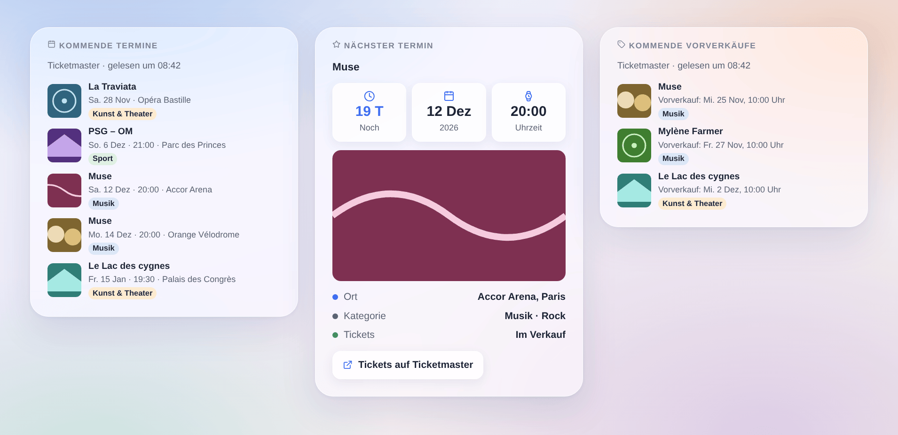

# Ticketmaster

## Überblick

Diese Integration bringt die **Konzerte, Shows, Spiele und Festivals**, die Ticketmaster listet, in Gladys. Sie wählen, was Sie verfolgen: die Veranstaltungen **rund ums Haus** (ein Umkreis und Kategorien), **Künstler und Teams** sowie **Veranstaltungsorte**. Für jeden Benutzer, der die Integration aktiviert, erscheinen bis zu drei Kalender; Szenen reagieren auf einen neuen Termin, eine Erinnerung, den **Start eines Vorverkaufs** oder eine Absage, und drei Dashboard-Widgets zeigen, was kommt.

Die Veranstaltungen stammen aus der offiziellen [Discovery API](https://developer.ticketmaster.com/products-and-docs/apis/discovery-api/v2/) von Ticketmaster, gelesen mit Ihrem eigenen kostenlosen Schlüssel.

## Voraussetzungen

- Gladys Assistant **5.3.0** oder neuer (Kalender-Integrationen).
- Internetzugang.
- Ein kostenloser Ticketmaster-API-Schlüssel: Registrieren Sie sich auf [developer-acct.ticketmaster.com](https://developer-acct.ticketmaster.com/user/register); der „Consumer Key“ der Standard-App („My Apps“) ist der Schlüssel. Er erlaubt 5.000 Anfragen pro Tag; die Integration braucht höchstens einige Hundert.
- Für „Rund ums Haus“: die Position des Hauses in Gladys (Einstellungen → Häuser).

## Konfiguration

1. Fügen Sie den **Ticketmaster-API-Schlüssel** ein und speichern Sie.
2. Wählen Sie, was Sie verfolgen; die drei Quellen addieren sich:
   - **Rund ums Haus**: ein Umkreis (5 bis 100 km oder aus), die Kategorien (Musik, Sport, Kunst & Theater, Film, Sonstiges) und wie weit im Voraus (30 Tage bis ein Jahr).
   - **Künstler und Teams**: die Schaltfläche **Künstler oder Team folgen**. Geben Sie den Namen so ein, wie Ticketmaster ihn schreibt („Muse“, „FC Bayern München“). Tragen mehrere Treffer diesen Namen, listet die Meldung sie mit ihrer Kennung: Um einem anderen zu folgen, entfernen Sie diesen und fügen dessen Kennung ein.
   - **Veranstaltungsorte**: die Schaltfläche **Veranstaltungsort folgen** („Mercedes-Benz Arena“), gesucht im unten gewählten Land; Namensvettern werden mit Stadt und Kennung aufgelistet.
3. Speichern Sie, dann klicken Sie auf derselben Seite unter **Meine Kalender** auf **Für mich aktivieren**.

| Feld                                           | Beschreibung                                                                                               |
| ---------------------------------------------- | ---------------------------------------------------------------------------------------------------------- |
| Ticketmaster-API-Schlüssel                     | Der „Consumer Key“ Ihrer App. Wird nur an Ticketmaster gesendet.                                           |
| Haus                                           | Das Haus für „Rund ums Haus“. Leer: das erste Haus mit Position.                                           |
| Umkreis                                        | Aus, 5, 10, 25 (Standard), 50 oder 100 km.                                                                 |
| Kategorien                                     | Standardmäßig Musik sowie Kunst & Theater; Sport, Film, Sonstiges.                                         |
| Wie weit im Voraus                             | 30 Tage, 3 Monate (Standard), 6 Monate oder ein Jahr.                                                      |
| Land der Termine verfolgter Künstler und Teams | Wo die Termine der verfolgten Künstler und Teams behalten werden (Standard: Frankreich, oder alle Länder). |
| Lesen von Ticketmaster                         | Alle 6, 12 (Standard) oder 24 Stunden.                                                                     |
| Stunde der Erinnerungen                        | Von 0 bis 23, Ortszeit (Standard 9).                                                                       |
| Sprache der Szenentexte                        | Sprache der fertigen Sätze und der Meldungen der Schaltflächen. Automatisch: die Sprache des Dashboards.   |

**Verfolgtes auflisten** zeigt den Umkreis sowie die Künstler, Teams und Orte mit ihren Kennungen; **Jetzt neu lesen** liest Ticketmaster sofort. Die verfolgten Künstler und Orte werden in der Konfiguration von Gladys gespeichert (sie folgen dessen Sicherungen) und sind für alle Benutzer gleich.

## Verwendung

### Kalender

Jeder Benutzer erhält bis zu drei Kalender, einen pro verwendeter Quellenart: **Meine Künstler und Teams**, **Meine Veranstaltungsorte** und **Veranstaltungen rund ums Haus**. Eine Veranstaltung steht nur in einem davon, dem persönlichsten: Ein Konzert eines verfolgten Künstlers an einem verfolgten Ort in der Nähe steht in „Meine Künstler und Teams“. Ist die Uhrzeit bekannt, ist es ein Termin mit Uhrzeit, sonst ein ganztägiger; die Beschreibung nennt Kategorie, Vorverkauf und Preise, der Ort den Veranstaltungsort, der Link die Ticketmaster-Seite. Eine Veranstaltung ohne angekündigten Termin steht nicht in den Kalendern (und nicht in den Widgets).

Eine abgesagte oder verschobene Veranstaltung bleibt, ihr Name sagt es („Abgesagt · …“). Die Kalender behalten eine Woche Rückblick und zwei Jahre Vorschau. Ein neuer Kalender ist **privat**: Schalten Sie unter **Meine Kalender** **Mit dem Haushalt teilen** ein, um ihn in Szenen zu nutzen (auch mit dem nativen Auslöser „Kalenderereignis steht bevor“).

### Dashboard-Widgets

- **Kommende Termine**: die nächsten 3, 5 oder 8 Veranstaltungen mit Tag, Uhrzeit, Ort, Kategorie und Bild. Tippen Sie auf eine für Details und ihre Ticketmaster-Seite.
- **Nächster Termin**: der Countdown, Tag, Uhrzeit, Ort und ein großes Bild, mit einer Schaltfläche zu den Tickets.
- **Kommende Vorverkäufe**: die nächsten Vorverkaufsstarts, um rechtzeitig bereit zu sein.

Jedes Widget lässt sich auf bestimmte Quellen (verfolgte Künstler und Teams, verfolgte Orte, rund ums Haus) und Kategorien beschränken.

### Szenen

Auslöser (Filter: Quelle, Kategorien und der Name eines Künstlers oder Teams genau wie Ticketmaster ihn schreibt):

- **Ticketmaster: neuer Termin**: eine neue Veranstaltung ist erschienen. Etwas Neues zu verfolgen kündigt nichts an: nur was danach erscheint.
- **Ticketmaster: Erinnerung**: eine Veranstaltung findet heute, morgen oder in einer Woche statt („Wann“), zur Stunde der Konfiguration.
- **Ticketmaster: Vorverkaufsstart**: der allgemeine Vorverkauf startet jetzt, in einer Stunde oder morgen („Wann“).
- **Ticketmaster: abgesagt oder verlegt**: abgesagt, verschoben, neuer Termin oder anderer Tag bzw. andere Uhrzeit („Änderung“); `previous_date` enthält das alte Datum.

Die Variablen: `name`, `date`, `time` (Ortszeit), `date_text`, `days`, `place`, `city`, `attraction`, `segment` (music, sports, arts, film, misc), `source` (artist, venue, nearby), `status`, `url`, `image_url`, `onsale`, `onsale_text`, `text` (ein fertiger Satz), `event_id`.

Aktion: **Ticketmaster: nächster Termin** liefert die nächste Veranstaltung (mit denselben Filtern): Name, Datum, Uhrzeit, Ort, Vorverkauf und einen fertigen Satz `text`; `found` ist falsch und `days` -1, wenn nichts passt.

Beispiele:

- Wenn **der Vorverkauf in einer Stunde startet** → `{{triggerEvent.data.text}}` und `{{triggerEvent.data.url}}` per Telegram senden.
- Wenn **ein verfolgter Künstler einen neuen Termin ankündigt** → `{{triggerEvent.data.text}}` senden.
- **Erinnerung am Tag selbst** um 17 Uhr → Gladys `{{triggerEvent.data.text}}` sagen lassen und das Licht im Flur einschalten.

### Transport

Nur Cloud. Ticketmaster erhält Ihren Schlüssel, die Kennungen der verfolgten Künstler, Teams und Orte und, für „Rund ums Haus“, die auf etwa 150 m gerundete Position des Hauses (ein Geohash), nie die Adresse. Die Bilder werden von den Servern von Ticketmaster geladen, wenn ein Dashboard sie zeigt. Sonst verlässt nichts Ihr Netzwerk.

## Fehlerbehebung

- **„Ticketmaster lehnt den API-Schlüssel ab“**: Fügen Sie den „Consumer Key“ (nicht das „Consumer Secret“) Ihrer App auf developer.ticketmaster.com ein.
- **„Tageskontingent des Schlüssels verbraucht“**: Die 5.000 Anfragen des Tages sind aufgebraucht (von dieser Integration oder einer anderen App mit demselben Schlüssel). Das Lesen geht weiter, sobald Ticketmaster das Kontingent zurücksetzt.
- **„Rund ums Haus“ ist aus**: Das Haus hat keine Position (Einstellungen → Häuser), oder der Umkreis ist aus.
- **Nichts rund ums Haus**: Ticketmaster listet nicht jede Veranstaltung jedes Landes; versuchen Sie einen größeren Umkreis oder andere Kategorien. In einer Großstadt bleiben bei mehr als 1.000 Veranstaltungen nur die nächsten Termine: Wählen Sie einen kleineren Umkreis oder weniger Tage („Verfolgtes auflisten“ zeigt es an).
- **Falscher Künstler oder Ort verfolgt**: Entfernen Sie ihn und fügen Sie die Kennung aus der Antwort der Schaltfläche ein.
- **Eine Welttournee füllt den Kalender**: Wählen Sie das Land der Termine der verfolgten Künstler.
- **Der Kalender bleibt leer**: Prüfen Sie **Für mich aktivieren** unter Meine Kalender, den Schlüssel und dass etwas verfolgt wird.

Für einen Fehlerbericht nennen Sie die Versionen von Gladys und der Integration, was verfolgt wird (ohne Schlüssel) und die Zeilen des Protokoll-Tabs der Integration; im Entwicklermodus fügt `DEBUG=gladys-integration-sdk` die SDK-Protokolle hinzu.
