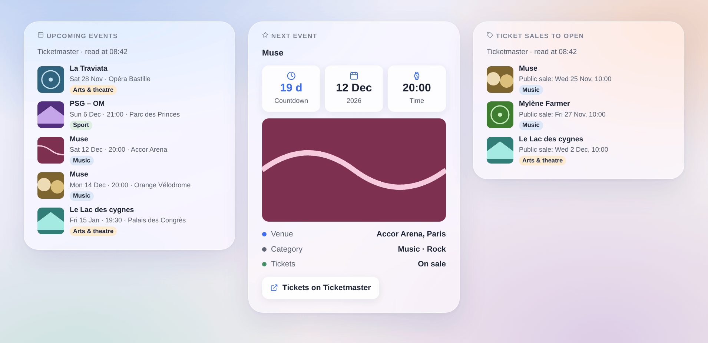

# Ticketmaster

## Overview

This integration brings **concerts, shows, matches and festivals** listed by Ticketmaster into Gladys. Choose what to follow: the events **around the house** (a radius and categories), **artists and teams**, and **venues**. Up to three calendars appear for every user who enables the integration, scenes can react to a new date, a reminder, the **opening of a ticket sale** or a canceled event, and three dashboard widgets show what is coming.

The events come from the official [Discovery API](https://developer.ticketmaster.com/products-and-docs/apis/discovery-api/v2/) of Ticketmaster, read with your own free key.

## Requirements

- Gladys Assistant **5.3.0** or later (calendar integrations).
- Internet access.
- A free Ticketmaster API key: register on [developer-acct.ticketmaster.com](https://developer-acct.ticketmaster.com/user/register); the "Consumer Key" of the default app ("My Apps") is the key. It allows 5,000 requests a day; the integration uses a few hundred at most.
- For "Around the house": the position of the house in Gladys (Settings → Houses).

## Configuration

1. Paste the **Ticketmaster API key** and save.
2. Choose what to follow, the three add up:
   - **Around the house**: a radius (5 to 100 km, or off), the categories (music, sport, arts and theatre, film, other) and how far ahead (30 days to a year).
   - **Artists and teams**: the **Follow an artist or a team** button. Type the name as Ticketmaster writes it ("Muse", "Paris Saint-Germain"). When several answers share the name, the message lists them with their identifier: to follow another one, stop following this one and paste its identifier.
   - **Venues**: the **Follow a venue** button ("Accor Arena", "Zénith"), searched in the country chosen below; namesakes are listed with their city and identifier.
3. Save, then, in **My calendars** on the same page, press **Enable for me**.

| Field                                                  | Description                                                                                                        |
| ------------------------------------------------------ | ------------------------------------------------------------------------------------------------------------------ |
| Ticketmaster API key                                   | The "Consumer Key" of your app. Only sent to Ticketmaster.                                                         |
| House                                                  | The house of "Around the house". Empty: the first house with a position.                                           |
| Radius                                                 | Off, 5, 10, 25 (default), 50 or 100 km.                                                                            |
| Categories                                             | Music and arts by default; sport, film, other.                                                                     |
| How far ahead                                          | 30 days, 3 months (default), 6 months or a year.                                                                   |
| Country of the dates of the followed artists and teams | Where the dates of the followed artists and teams are kept (France by default, or every country).                  |
| Reading of Ticketmaster                                | Every 6, 12 (default) or 24 hours.                                                                                 |
| Hour of the reminders                                  | From 0 to 23, local time (9 by default).                                                                           |
| Language of the scene texts                            | Language of the ready-made sentences and of the messages of the buttons. Automatic: the language of the dashboard. |

**List what is followed** shows the radius, the artists, teams and venues with their identifiers; **Read again now** reads Ticketmaster at once. The followed artists and venues are kept in the configuration of Gladys (they follow its backups) and are the same for every user.

## Usage

### Calendars

Each user gets up to three calendars, one per kind of source in use: **My artists and teams**, **My venues** and **Events around the house**. An event lives in one of them only, the most personal one: a concert of a followed artist in a followed venue near the house is in "My artists and teams". An event whose time is known is a timed event, otherwise an all-day one; its description gives the category, the public sale and the prices, its location the venue, its link the Ticketmaster page. An event whose date is not announced yet is not in the calendars (the widgets do not list it either).

A canceled or postponed event stays, its name says so ("Canceled · …"). The calendars keep a week of history and two years ahead. A new calendar is **private**: in **My calendars**, turn **Share with the household** on to use it in the scenes (and with the native trigger "Calendar event is coming").

### Dashboard widgets

- **Upcoming events**: the next 3, 5 or 8 events, with the day, time, venue, category and picture. Tap one for its details and its Ticketmaster page.
- **Next event**: the countdown, the day, the time, the venue and a large picture, with a button to the tickets.
- **Ticket sales to open**: the next public sales, to be ready on time.

Each can be limited to some sources (followed artists and teams, followed venues, around the house) and some categories.

### Scenes

Triggers (filters: source, categories, and the name of an artist or team exactly as Ticketmaster writes it):

- **Ticketmaster: new date**: a new event appeared. Following something new announces nothing: only what appears afterwards does.
- **Ticketmaster: reminder**: an event takes place today, tomorrow or in a week ("When"), at the hour of the configuration.
- **Ticketmaster: ticket sale opens**: the public sale opens now, in an hour or tomorrow ("When").
- **Ticketmaster: canceled or moved**: canceled, postponed, new date, or another day or time ("Change"); `previous_date` holds the old date.

The variables: `name`, `date`, `time` (local time of the venue), `date_text`, `days`, `place`, `city`, `attraction`, `segment` (music, sports, arts, film, misc), `source` (artist, venue, nearby), `status`, `url`, `image_url`, `onsale`, `onsale_text`, `text` (a ready-made sentence), `event_id`.

Action: **Ticketmaster: next event** gives the next event (with the same filters): name, date, time, venue, sale and a ready-made sentence `text`; `found` is false and `days` -1 when nothing matches.

Examples:

- When **the ticket sale opens in an hour** → send `{{triggerEvent.data.text}}` and `{{triggerEvent.data.url}}` on Telegram.
- When **a followed artist announces a new date** → send `{{triggerEvent.data.text}}`.
- **Reminder the day of the event** at 5 pm → have Gladys say `{{triggerEvent.data.text}}` and turn on the hall light.

### Transport

Cloud only. Ticketmaster receives your key, the identifiers of the followed artists, teams and venues, and, for "Around the house", the position of the house rounded to about 150 m (a geohash), never the address. The pictures are downloaded from Ticketmaster's servers when a dashboard shows them. Nothing else leaves your network.

## Troubleshooting

- **"Ticketmaster refuses the API key"**: paste the "Consumer Key" (not the "Consumer Secret") of your app on developer.ticketmaster.com.
- **"Daily quota of the key spent"**: the 5,000 requests of the day are used (by this integration or another app with the same key). The reading resumes when Ticketmaster resets the quota.
- **"Around the house" is off**: the house has no position (Settings → Houses), or the radius is off.
- **Nothing around the house**: Ticketmaster does not list every event of every country; try a larger radius or other categories. In a big city, more than 1,000 events only keep the nearest dates: choose a smaller radius or fewer days ("List what is followed" tells it).
- **The wrong artist or venue was followed**: stop following it, then paste the identifier listed by the answer of the button.
- **A world tour fills the calendar**: choose the country of the dates of the followed artists.
- **The calendar stays empty**: check **Enable for me** in My calendars, the key, and that something is followed.

For a bug report, give the Gladys and integration versions, what is followed (no key), and the lines of the Logs tab of the integration; in developer mode, `DEBUG=gladys-integration-sdk` adds the SDK logs.
