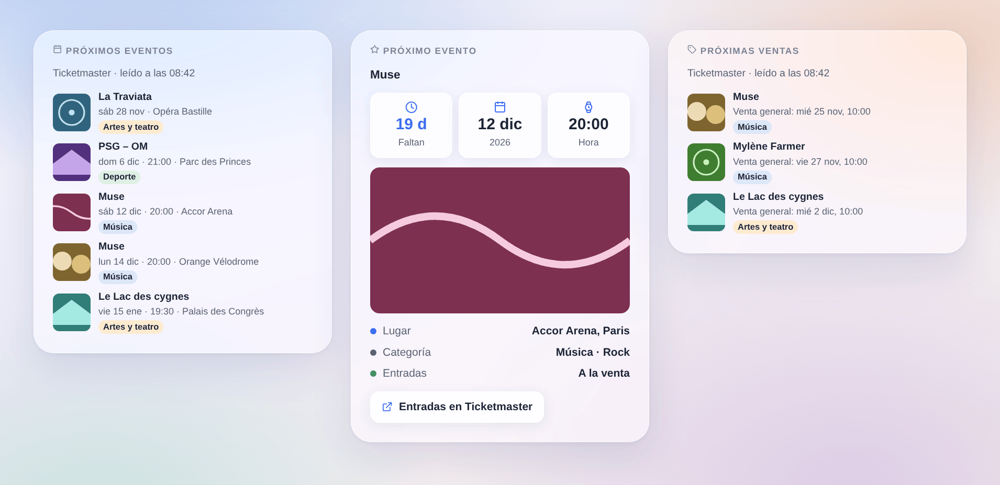

# Ticketmaster

## Presentación

Esta integración lleva a Gladys los **conciertos, espectáculos, partidos y festivales** que lista Ticketmaster. Usted elige qué seguir: los eventos **alrededor de la casa** (un radio y categorías), **artistas y equipos**, y **recintos**. Aparecen hasta tres calendarios para cada usuario que activa la integración, las escenas reaccionan a una nueva fecha, a un recordatorio, a la **apertura de una venta de entradas** o a una cancelación, y tres widgets del panel muestran lo que viene.

Los eventos proceden de la [API Discovery](https://developer.ticketmaster.com/products-and-docs/apis/discovery-api/v2/) oficial de Ticketmaster, leída con su propia clave gratuita.

## Requisitos

- Gladys Assistant **5.3.0** o posterior (integraciones de calendario).
- Acceso a Internet.
- Una clave de API de Ticketmaster gratuita: regístrese en [developer-acct.ticketmaster.com](https://developer-acct.ticketmaster.com/user/register); la «Consumer Key» de la aplicación por defecto («My Apps») es la clave. Permite 5.000 peticiones al día; la integración usa unos cientos como máximo.
- Para «Alrededor de la casa»: la posición de la casa en Gladys (Ajustes → Casas).

## Configuración

1. Pegue la **clave de API de Ticketmaster** y guarde.
2. Elija qué seguir; las tres fuentes se suman:
   - **Alrededor de la casa**: un radio (5 a 100 km, o desactivado), las categorías (música, deporte, artes y teatro, cine, otros) y hasta cuándo (30 días a un año).
   - **Artistas y equipos**: el botón **Seguir a un artista o equipo**. Escriba el nombre tal como lo escribe Ticketmaster («Muse», «Real Madrid»). Cuando varias respuestas comparten el nombre, el mensaje las lista con su identificador: para seguir otra, deje de seguir esta y pegue su identificador.
   - **Recintos**: el botón **Seguir un recinto** («WiZink Center»), buscado en el país elegido más abajo; los homónimos se listan con su ciudad e identificador.
3. Guarde y, en **Mis calendarios** en la misma página, pulse **Activar para mí**.

| Campo                                             | Descripción                                                                                                 |
| ------------------------------------------------- | ----------------------------------------------------------------------------------------------------------- |
| Clave de API de Ticketmaster                      | La «Consumer Key» de su aplicación. Solo se envía a Ticketmaster.                                           |
| Casa                                              | La casa de «Alrededor de la casa». Vacío: la primera casa con posición.                                     |
| Radio                                             | Desactivado, 5, 10, 25 (por defecto), 50 o 100 km.                                                          |
| Categorías                                        | Música y artes y teatro por defecto; deporte, cine, otros.                                                  |
| Hasta cuándo                                      | 30 días, 3 meses (por defecto), 6 meses o un año.                                                           |
| País de las fechas de artistas y equipos seguidos | Dónde se conservan las fechas de los artistas y equipos seguidos (Francia por defecto, o todos los países). |
| Lectura de Ticketmaster                           | Cada 6, 12 (por defecto) o 24 horas.                                                                        |
| Hora de los recordatorios                         | De 0 a 23, hora local (9 por defecto).                                                                      |
| Idioma de los textos de las escenas               | Idioma de las frases hechas y de los mensajes de los botones. Automático: el idioma del panel.              |

**Listar lo que se sigue** muestra el radio y los artistas, equipos y recintos con sus identificadores; **Volver a leer ahora** lee Ticketmaster al instante. Los artistas y recintos seguidos se guardan en la configuración de Gladys (siguen sus copias de seguridad) y son los mismos para todos los usuarios.

## Uso

### Calendarios

Cada usuario obtiene hasta tres calendarios, uno por tipo de fuente en uso: **Mis artistas y equipos**, **Mis recintos** y **Eventos alrededor de casa**. Un evento solo está en uno de ellos, el más personal: un concierto de un artista seguido en un recinto seguido cerca de casa está en «Mis artistas y equipos». Si se conoce la hora, es un evento con hora; si no, de día completo; su descripción da la categoría, la venta y los precios, su lugar el recinto y su enlace la página de Ticketmaster. Un evento sin fecha anunciada no está en los calendarios (ni en los widgets).

Un evento cancelado o aplazado se queda y su nombre lo indica («Cancelado · …»). Los calendarios guardan una semana de historial y dos años por delante. Un calendario nuevo es **privado**: en **Mis calendarios**, active **Compartir con el hogar** para usarlo en las escenas (y con el disparador nativo «Se acerca un evento del calendario»).

### Widgets del panel

- **Próximos eventos**: los 3, 5 u 8 próximos eventos, con día, hora, recinto, categoría e imagen. Toque uno para ver su detalle y su página de Ticketmaster.
- **Próximo evento**: la cuenta atrás, el día, la hora, el lugar y una imagen grande, con un botón hacia las entradas.
- **Próximas ventas**: las próximas aperturas de venta, para estar listo a tiempo.

Cada uno puede limitarse a ciertas fuentes (artistas y equipos seguidos, recintos seguidos, alrededor de la casa) y categorías.

### Escenas

Disparadores (filtros: fuente, categorías y nombre de un artista o equipo exactamente como lo escribe Ticketmaster):

- **Ticketmaster: nueva fecha**: ha aparecido un nuevo evento. Seguir algo nuevo no anuncia nada: solo lo que aparece después.
- **Ticketmaster: recordatorio**: un evento tiene lugar hoy, mañana o dentro de una semana («Cuándo»), a la hora de la configuración.
- **Ticketmaster: apertura de venta**: la venta general abre ahora, dentro de una hora o mañana («Cuándo»).
- **Ticketmaster: cancelado o cambiado**: cancelado, aplazado, nueva fecha, u otro día u hora («Cambio»); `previous_date` contiene la fecha anterior.

Las variables: `name`, `date`, `time` (hora local del recinto), `date_text`, `days`, `place`, `city`, `attraction`, `segment` (music, sports, arts, film, misc), `source` (artist, venue, nearby), `status`, `url`, `image_url`, `onsale`, `onsale_text`, `text` (una frase hecha), `event_id`.

Acción: **Ticketmaster: próximo evento** da el próximo evento (con los mismos filtros): nombre, fecha, hora, lugar, venta y una frase hecha `text`; `found` es falso y `days` -1 cuando nada coincide.

Ejemplos:

- Cuando **la venta abre dentro de una hora** → enviar `{{triggerEvent.data.text}}` y `{{triggerEvent.data.url}}` por Telegram.
- Cuando **un artista seguido anuncia una nueva fecha** → enviar `{{triggerEvent.data.text}}`.
- **Recordatorio el mismo día** a las 17:00 → hacer que Gladys diga `{{triggerEvent.data.text}}` y encender la luz de la entrada.

### Transporte

Solo nube. Ticketmaster recibe su clave, los identificadores de los artistas, equipos y recintos seguidos y, para «Alrededor de la casa», la posición de la casa redondeada a unos 150 m (un geohash), nunca la dirección. Las imágenes se descargan de los servidores de Ticketmaster cuando un panel las muestra. Nada más sale de su red.

## Solución de problemas

- **«Ticketmaster rechaza la clave de API»**: pegue la «Consumer Key» (no el «Consumer Secret») de su aplicación en developer.ticketmaster.com.
- **«Cuota diaria de la clave agotada»**: se han usado las 5.000 peticiones del día (por esta integración u otra aplicación con la misma clave). La lectura se reanuda cuando Ticketmaster restablece la cuota.
- **«Alrededor de la casa» está inactivo**: la casa no tiene posición (Ajustes → Casas), o el radio está desactivado.
- **Nada alrededor de la casa**: Ticketmaster no lista todos los eventos de todos los países; pruebe un radio mayor u otras categorías. En una gran ciudad, por encima de 1.000 eventos solo se guardan las fechas más cercanas: elija un radio o un periodo menor («Listar lo que se sigue» lo indica).
- **Se siguió el artista o recinto equivocado**: deje de seguirlo y pegue el identificador que lista la respuesta del botón.
- **Una gira mundial llena el calendario**: elija el país de las fechas de los artistas seguidos.
- **El calendario sigue vacío**: compruebe **Activar para mí** en Mis calendarios, la clave y que se sigue algo.

Para informar de un error, indique las versiones de Gladys y de la integración, lo que se sigue (sin la clave) y las líneas de la pestaña Registros de la integración; en modo desarrollador, `DEBUG=gladys-integration-sdk` añade los registros del SDK.
