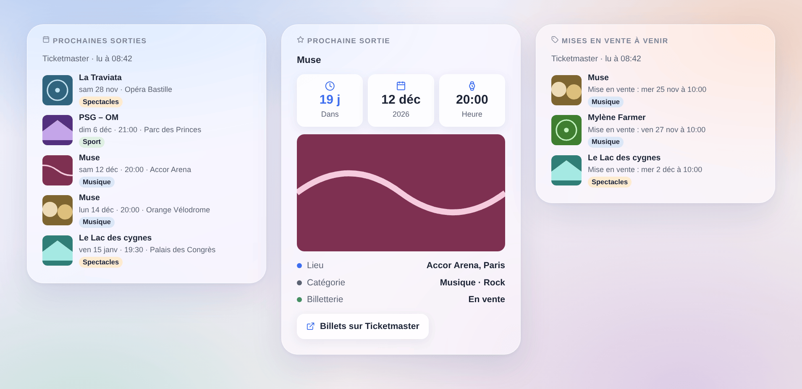

# Ticketmaster

## Présentation

Cette intégration amène dans Gladys les **concerts, spectacles, matchs et festivals** que liste Ticketmaster. Vous choisissez ce que vous suivez : les sorties **autour de la maison** (un rayon et des catégories), des **artistes et équipes**, et des **salles**. Jusqu’à trois calendriers apparaissent pour chaque utilisateur qui active l’intégration, les scènes réagissent à une nouvelle date, à un rappel, à l’**ouverture d’une billetterie** ou à une annulation, et trois widgets du tableau de bord montrent ce qui arrive.

Les sorties viennent de l’[API Discovery](https://developer.ticketmaster.com/products-and-docs/apis/discovery-api/v2/) officielle de Ticketmaster, lue avec votre propre clé gratuite.

## Prérequis

- Gladys Assistant **5.3.0** ou plus récent (intégrations de calendrier).
- Un accès à Internet.
- Une clé d’API Ticketmaster gratuite : inscrivez-vous sur [developer-acct.ticketmaster.com](https://developer-acct.ticketmaster.com/user/register) ; la « Consumer Key » de l’application par défaut (« My Apps ») est la clé. Elle permet 5 000 requêtes par jour ; l’intégration en utilise quelques centaines au plus.
- Pour « Autour de la maison » : la position de la maison dans Gladys (Paramètres → Maisons).

## Configuration

1. Collez la **clé d’API Ticketmaster** et enregistrez.
2. Choisissez ce que vous suivez, les trois s’additionnent :
   - **Autour de la maison** : un rayon (5 à 100 km, ou désactivé), les catégories (musique, sport, spectacles, cinéma, divers) et jusqu’à quand (30 jours à un an).
   - **Artistes et équipes** : le bouton **Suivre un artiste ou une équipe**. Saisissez le nom tel que Ticketmaster l’écrit (« Muse », « Paris Saint-Germain »). Quand plusieurs réponses portent ce nom, le message les liste avec leur identifiant : pour en suivre une autre, ne suivez plus celle-ci et collez son identifiant.
   - **Salles** : le bouton **Suivre une salle** (« Accor Arena », « Zénith »), cherchée dans le pays choisi plus bas ; les homonymes sont listés avec leur ville et leur identifiant.
3. Enregistrez, puis, dans **Mes calendriers** sur la même page, cliquez sur **Activer pour moi**.

| Champ                                         | Description                                                                                               |
| --------------------------------------------- | --------------------------------------------------------------------------------------------------------- |
| Clé d’API Ticketmaster                        | La « Consumer Key » de votre application. Envoyée uniquement à Ticketmaster.                              |
| Maison                                        | La maison de « Autour de la maison ». Vide : la première maison qui a une position.                       |
| Rayon                                         | Désactivé, 5, 10, 25 (par défaut), 50 ou 100 km.                                                          |
| Catégories                                    | Musique et spectacles par défaut ; sport, cinéma, divers.                                                 |
| Jusqu’à quand                                 | 30 jours, 3 mois (par défaut), 6 mois ou un an.                                                           |
| Pays des dates des artistes et équipes suivis | Où les dates des artistes et équipes suivis sont gardées (France par défaut, ou tous les pays).           |
| Lecture de Ticketmaster                       | Toutes les 6, 12 (par défaut) ou 24 heures.                                                               |
| Heure des rappels                             | De 0 à 23, heure locale (9 par défaut).                                                                   |
| Langue des textes des scènes                  | Langue des phrases toutes faites et des messages des boutons. Automatique : la langue du tableau de bord. |

**Lister ce qui est suivi** affiche le rayon, les artistes, équipes et salles avec leurs identifiants ; **Relire maintenant** lit Ticketmaster tout de suite. Les artistes et salles suivis sont gardés dans la configuration de Gladys (ils suivent ses sauvegardes) et sont les mêmes pour tous les utilisateurs.

## Utilisation

### Calendriers

Chaque utilisateur obtient jusqu’à trois calendriers, un par type de source utilisé : **Mes artistes et équipes**, **Mes salles** et **Sorties autour de la maison**. Une sortie n’est que dans un seul, le plus personnel : un concert d’un artiste suivi dans une salle suivie près de la maison est dans « Mes artistes et équipes ». Une sortie dont l’heure est connue est un événement horaire, sinon un événement sur la journée ; sa description donne la catégorie, la mise en vente et les prix, son lieu la salle, son lien la page Ticketmaster. Une sortie dont la date n’est pas encore annoncée n’est pas dans les calendriers (ni dans les widgets).

Une sortie annulée ou reportée reste, son nom le dit (« Annulé · … »). Les calendriers gardent une semaine d’historique et deux ans à venir. Un nouveau calendrier est **privé** : dans **Mes calendriers**, activez **Partager avec la maison** pour l’utiliser dans les scènes (et avec le déclencheur natif « Un événement du calendrier approche »).

### Widgets du tableau de bord

- **Prochaines sorties** : les 3, 5 ou 8 prochaines sorties, avec jour, heure, salle, catégorie et image. Touchez-en une pour son détail et sa page Ticketmaster.
- **Prochaine sortie** : le compte à rebours, le jour, l’heure, le lieu et une grande image, avec un bouton vers les billets.
- **Mises en vente à venir** : les prochaines ouvertures de billetterie, pour être prêt à l’heure.

Chacun peut se limiter à certaines sources (artistes et équipes suivis, salles suivies, autour de la maison) et à certaines catégories.

### Scènes

Déclencheurs (filtres : source, catégories, et nom d’un artiste ou d’une équipe exactement comme Ticketmaster l’écrit) :

- **Ticketmaster : nouvelle date** : une nouvelle sortie est apparue. Suivre quelque chose de nouveau n’annonce rien : seul ce qui apparaît ensuite l’est.
- **Ticketmaster : rappel** : une sortie a lieu aujourd’hui, demain ou dans une semaine (« Quand »), à l’heure de la configuration.
- **Ticketmaster : mise en vente** : la billetterie grand public ouvre maintenant, dans une heure ou demain (« Quand »).
- **Ticketmaster : annulé ou déplacé** : annulé, reporté, nouvelle date, ou autre jour ou heure (« Changement ») ; `previous_date` donne l’ancienne date.

Les variables : `name`, `date`, `time` (heure locale du lieu), `date_text`, `days`, `place`, `city`, `attraction`, `segment` (music, sports, arts, film, misc), `source` (artist, venue, nearby), `status`, `url`, `image_url`, `onsale`, `onsale_text`, `text` (une phrase toute faite), `event_id`.

Action : **Ticketmaster : prochaine sortie** donne la prochaine sortie (avec les mêmes filtres) : nom, date, heure, lieu, mise en vente et une phrase toute faite `text` ; `found` vaut faux et `days` -1 quand rien ne correspond.

Exemples :

- Quand **la billetterie ouvre dans une heure** → envoyer `{{triggerEvent.data.text}}` et `{{triggerEvent.data.url}}` sur Telegram.
- Quand **un artiste suivi annonce une nouvelle date** → envoyer `{{triggerEvent.data.text}}`.
- **Rappel le jour même** à 17 h → faire dire `{{triggerEvent.data.text}}` à Gladys et allumer l’entrée.

### Transport

Cloud uniquement. Ticketmaster reçoit votre clé, les identifiants des artistes, équipes et salles suivis et, pour « Autour de la maison », la position de la maison arrondie à environ 150 m (un geohash), jamais l’adresse. Les images sont téléchargées depuis les serveurs de Ticketmaster quand un tableau de bord les affiche. Rien d’autre ne quitte votre réseau.

## Dépannage

- **« Ticketmaster refuse la clé d’API »** : collez la « Consumer Key » (pas le « Consumer Secret ») de votre application sur developer.ticketmaster.com.
- **« Quota quotidien de la clé épuisé »** : les 5 000 requêtes du jour sont utilisées (par cette intégration ou une autre application avec la même clé). La lecture reprend quand Ticketmaster remet le quota à zéro.
- **« Autour de la maison » est inactif** : la maison n’a pas de position (Paramètres → Maisons), ou le rayon est désactivé.
- **Rien autour de la maison** : Ticketmaster ne liste pas toutes les sorties de tous les pays ; essayez un rayon plus grand ou d’autres catégories. Dans une grande ville, au-delà de 1 000 sorties, seules les dates les plus proches sont gardées : choisissez un rayon ou une durée plus petits (« Lister ce qui est suivi » le signale).
- **Le mauvais artiste ou la mauvaise salle est suivi** : ne le suivez plus, puis collez l’identifiant listé par la réponse du bouton.
- **Une tournée mondiale remplit le calendrier** : choisissez le pays des dates des artistes suivis.
- **Le calendrier reste vide** : vérifiez **Activer pour moi** dans Mes calendriers, la clé, et que quelque chose est suivi.

Pour signaler un problème, indiquez les versions de Gladys et de l’intégration, ce qui est suivi (sans la clé) et les lignes de l’onglet Journaux de l’intégration ; en mode développeur, `DEBUG=gladys-integration-sdk` ajoute les journaux du SDK.
